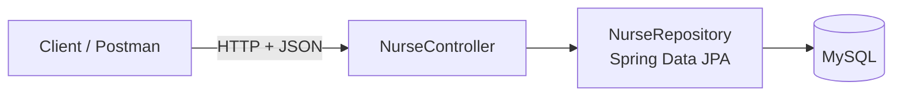
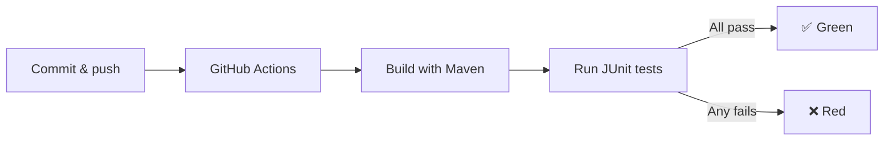

# Hospital Nurse API 🏥


A REST API built with **Spring Boot** to manage the nurses of a hospital. It supports the full set of CRUD operations (create, read, update and delete) and validates nurse logins.

The project also includes a **continuous integration** pipeline with GitHub Actions that runs the unit tests on every push and pull request, so errors are detected early.

---

## 📐 Architecture



| Layer | Class | Responsibility |
|---|---|---|
| Controller | `NurseController` | Exposes the REST endpoints, validates input and returns the HTTP status codes |
| Repository | `NurseRepository` | Accesses the database through Spring Data JPA |
| Entity | `Nurse` | Represents a nurse (`id`, `name`, `user`, `password`) |

### Continuous integration flow



---

## ✨ Features

- 👩‍⚕️ **Create nurses** with validation of required fields and unique usernames.
- 🔎 **Find nurses** by id or by name (partial, case-insensitive search).
- ✏️ **Update nurses** by id.
- 🗑️ **Delete nurses** by id.
- 🔐 **Login** with username and password.
- ✅ **Unit tests** covering every endpoint of `NurseController`.
- ⚙️ **CI pipeline** that runs the tests automatically.

---

## 🛠️ Tech Stack

| Category | Technology |
|---|---|
| Language | Java 17 |
| Framework | Spring Boot 4.1.1 (Web MVC, Data JPA) |
| Database | MySQL (MySQL Connector/J) |
| Build tool | Maven |
| Testing | JUnit, Mockito, MockMvc |
| CI | GitHub Actions |

---

## 🚀 Installation

### Prerequisites

- [Git](https://git-scm.com/)
- [Java JDK 17](https://adoptium.net/) or higher
- A MySQL database
- Maven is optional: the project includes the Maven Wrapper (`mvnw`)

### Steps

1. **Clone the repository:**

   ```bash
   git clone https://github.com/SebasImitolaFernandez/Hospital.git
   cd Hospital
   ```

2. **Configure the database** in `src/main/resources/application.properties`:

   ```properties
   spring.datasource.url=jdbc:mysql://<host>:3306/<database>
   spring.datasource.username=<user>
   spring.datasource.password=<password>
   ```

3. **Install dependencies and build:**

   ```bash
   ./mvnw clean install
   ```

   On Windows use `mvnw.cmd clean install`.

---

## 💻 Usage

### Run the application

```bash
./mvnw spring-boot:run
```

The API will be available at `http://localhost:8080`.

### Endpoints

| Method | Route | Description | Responses |
|---|---|---|---|
| `GET` | `/nurse/index` | List all nurses | `200` |
| `GET` | `/nurse/id/{id}` | Find a nurse by id | `200`, `404` |
| `GET` | `/nurse/name/{name}` | Find nurses by name | `200`, `404` |
| `POST` | `/nurse/create` | Create a nurse | `201`, `400`, `409` |
| `PUT` | `/nurse/{id}` | Update a nurse | `200`, `400`, `404`, `409` |
| `DELETE` | `/nurse/{id}` | Delete a nurse | `200`, `404` |
| `POST` | `/nurse/login` | Validate username and password | `200`, `401` |

**Status codes:**

- `200 OK` – Request completed successfully.
- `201 Created` – Nurse created.
- `400 Bad Request` – Missing or empty fields (`name`, `user` and `password` are required).
- `401 Unauthorized` – Wrong username or password.
- `404 Not Found` – No nurse with that id or name.
- `409 Conflict` – The username is already taken.

### Examples

**Create a nurse**

```http
POST /nurse/create
Content-Type: application/json

{
  "name": "Ana",
  "user": "ana",
  "password": "1234"
}
```

Returns `201 Created` with the new nurse.

**Update a nurse**

```http
PUT /nurse/1
Content-Type: application/json

{
  "name": "Ana María",
  "user": "ana",
  "password": "newpass"
}
```

Returns `200 OK` with the updated nurse. All three fields must be sent.

**Login**

```http
POST /nurse/login
Content-Type: application/json

{
  "user": "ana",
  "password": "1234"
}
```

Returns `true` with `200 OK` if the credentials are correct, or `false` with `401 Unauthorized` otherwise.

**Delete a nurse**

```http
DELETE /nurse/1
```

Returns `200 OK` if it was deleted, or `404 Not Found` if it does not exist.

---

## 🧪 Tests

Run the unit tests:

```bash
./mvnw test
```

The tests live in `src/test/java/com/stucom/Hospital/NurseControllerTests.java` and cover every endpoint of `NurseController`, including both success and error cases. They use **Mockito** to simulate the repository, so they do not need a database and run quickly in the pipeline.

`HospitalApplicationTests` is disabled because it starts the whole application and needs a connection to the real database, which is not available in CI.

---

## ⚙️ Continuous Integration

The workflow in `.github/workflows/maven.yml` builds the project and runs `mvn test` automatically. The results can be checked in the **Actions** tab of the repository, and the badge at the top of this README shows the current status.

---

## 👥 Authors

- Jeremy Tandazo
- Sebastian Imitola
- Daniel Lop
- Laia 
